<div align="center">

<picture>
  <source media="(prefers-color-scheme: dark) and (max-width: 640px)" srcset="assets/readme/dark/hm-hero.svg">
  <source media="(prefers-color-scheme: dark)" srcset="assets/readme/dark/hero.svg">
  <source media="(max-width: 640px)" srcset="assets/readme/light/hm-hero.svg">
  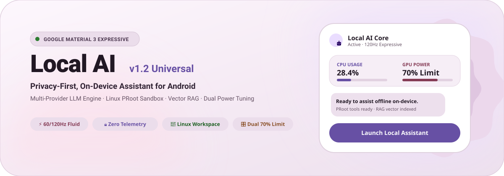
</picture>

<br><br>

<p align="center">
<a href="https://github.com/smartworldarafath/Local-AI/releases"><picture><source media="(prefers-color-scheme: dark)" srcset="assets/readme/dark/btn-download.svg">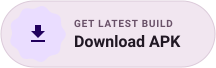</picture></a>
<a href="https://github.com/smartworldarafath/Local-AI"><picture><source media="(prefers-color-scheme: dark)" srcset="assets/readme/dark/btn-github.svg"></picture></a>
<a href="#support"><picture><source media="(prefers-color-scheme: dark)" srcset="assets/readme/dark/btn-sponsor.svg"></picture></a>
<a href="https://github.com/smartworldarafath/Local-AI/releases"><picture><source media="(prefers-color-scheme: dark)" srcset="assets/readme/dark/btn-releases.svg"></picture></a>
</p>

<p align="center">
<a href="#overview" title="Android 14+ / 16 Native"><picture><source media="(prefers-color-scheme: dark)" srcset="assets/readme/dark/badge-android.svg"></picture></a>
<a href="#faq" title="100% On-Device Privacy"><picture><source media="(prefers-color-scheme: dark)" srcset="assets/readme/dark/badge-privacy.svg"></picture></a>
<a href="#features" title="Google Material 3 Expressive"><picture><source media="(prefers-color-scheme: dark)" srcset="assets/readme/dark/badge-m3e.svg"></picture></a>
<a href="#features" title="Embedded Linux PRoot Sandbox"><picture><source media="(prefers-color-scheme: dark)" srcset="assets/readme/dark/badge-proot.svg"></picture></a>
<a href="#faq" title="Zero Telemetry & Tracking"><picture><source media="(prefers-color-scheme: dark)" srcset="assets/readme/dark/badge-zerotelemetry.svg"></picture></a>
<a href="#features" title="Multimodal Vision, Voice & Speech"><picture><source media="(prefers-color-scheme: dark)" srcset="assets/readme/dark/badge-multimodal.svg"></picture></a>
<a href="LICENSE" title="GPL-3.0 License"><picture><source media="(prefers-color-scheme: dark)" srcset="assets/readme/dark/badge-gpl.svg"></picture></a>
<a href="https://github.com/smartworldarafath/Local-AI/pulls" title="Pull Requests Welcome"><picture><source media="(prefers-color-scheme: dark)" srcset="assets/readme/dark/badge-prs.svg"></picture></a>
</p>

</div>

<h3 id="overview"><picture><source media="(prefers-color-scheme: dark) and (max-width: 640px)" srcset="assets/readme/dark/hm-overview.svg"><source media="(prefers-color-scheme: dark)" srcset="assets/readme/dark/h-overview.svg"><source media="(max-width: 640px)" srcset="assets/readme/light/hm-overview.svg">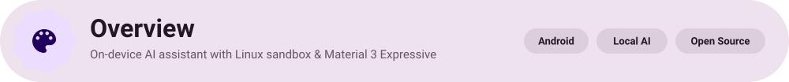</picture></h3>

**Local AI** is a state-of-the-art, open-source AI assistant application for Android engineered around **Google's Material 3 Expressive** design system. 

It provides an entirely private, locally sandboxed environment that unites multi-provider LLM routing, local vector memory (RAG), embedded Linux PRoot workspaces, real-time hardware telemetry, and fluid 60Hz/120Hz spring physics. 

All conversations, API keys, documents, vector embeddings, and tool executions reside **100% securely on your device**. There is zero telemetry, zero analytics tracking, and no external middleman server.

<table width="100%"><thead><tr><th align="left" width="28%">Quick facts</th><th align="left">Details</th></tr></thead><tbody>
<tr><td><b>Application name</b></td><td>Local AI (v1.2 Universal Release)</td></tr>
<tr><td><b>Repository</b></td><td><a href="https://github.com/smartworldarafath/Local-AI">smartworldarafath/Local-AI</a></td></tr>
<tr><td><b>Target Platform</b></td><td>Android 9.0+ (API 28 to API 36 / Android 16) · Single Universal APK (180.8 MB)</td></tr>
<tr><td><b>UI System</b></td><td>Google Material 3 Expressive (Jetpack Compose 1.8 · Shapes, Springs & Micro-motions)</td></tr>
<tr><td><b>Display Optimization</b></td><td>Dynamic High Refresh Rate (60Hz & 120Hz ProMotion fluid timing)</td></tr>
<tr><td><b>Native Sandbox</b></td><td>Embedded PRoot Linux user-space environment (CMake / C++ native core)</td></tr>
<tr><td><b>AI Architecture</b></td><td>Multi-Provider Engine (OpenAI, Gemini, Claude, ComfyUI, Ollama, SiliconFlow)</td></tr>
<tr><td><b>Memory & RAG</b></td><td>Local Vector Embeddings + SQLite Vector Engine (Room Database v33)</td></tr>
<tr><td><b>Security & Keys</b></td><td>Hardware-backed Android Keystore + EncryptedSharedPreferences (AES-256)</td></tr>
<tr><td><b>In-App Updates</b></td><td>GitHub Releases API with live speed monitor (MB/s) and background persistence</td></tr>
<tr><td><b>License</b></td><td>GNU General Public License v3.0 (GPL-3.0)</td></tr>
</tbody></table>

<div align="center">

<a href="https://github.com/smartworldarafath/Local-AI/issues"><picture><source media="(prefers-color-scheme: dark)" srcset="assets/readme/dark/btn-issues.svg"></picture></a>
<a href="https://github.com/smartworldarafath/Local-AI/pulls"><picture><source media="(prefers-color-scheme: dark)" srcset="assets/readme/dark/btn-releases.svg"></picture></a>
<a href="#support"><picture><source media="(prefers-color-scheme: dark)" srcset="assets/readme/dark/btn-sponsor.svg"></picture></a>
<a href="LICENSE"><picture><source media="(prefers-color-scheme: dark)" srcset="assets/readme/dark/btn-license.svg"></picture></a>

</div>

<h3 id="features"><picture><source media="(prefers-color-scheme: dark) and (max-width: 640px)" srcset="assets/readme/dark/hm-features.svg"><source media="(prefers-color-scheme: dark)" srcset="assets/readme/dark/h-features.svg"><source media="(max-width: 640px)" srcset="assets/readme/light/hm-features.svg"></picture></h3>

<div align="center">

| | |
|:---:|:---:|
| <a href="#features" title="Material 3 Expressive"><picture><source media="(prefers-color-scheme: dark)" srcset="assets/readme/dark/card-m3e.svg">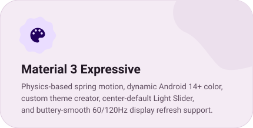</picture></a> | <a href="#features" title="Multi-Provider Routing"><picture><source media="(prefers-color-scheme: dark)" srcset="assets/readme/dark/card-providers.svg">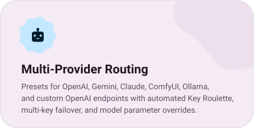</picture></a> |
| <a href="#features" title="Local RAG & Vector Memory"><picture><source media="(prefers-color-scheme: dark)" srcset="assets/readme/dark/card-rag.svg">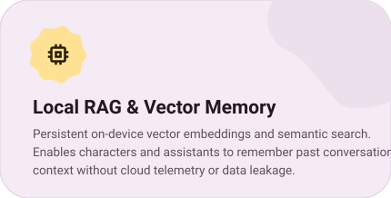</picture></a> | <a href="#features" title="Linux PRoot Workspace"><picture><source media="(prefers-color-scheme: dark)" srcset="assets/readme/dark/card-proot.svg">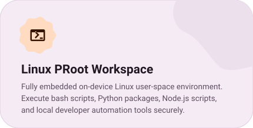</picture></a> |
| <a href="#hardware" title="Real-Time Hardware Monitor"><picture><source media="(prefers-color-scheme: dark)" srcset="assets/readme/dark/card-hardware.svg">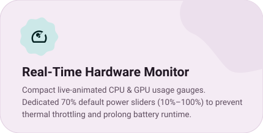</picture></a> | <a href="#features" title="Multimodal Vision & Voice"><picture><source media="(prefers-color-scheme: dark)" srcset="assets/readme/dark/card-multimodal.svg">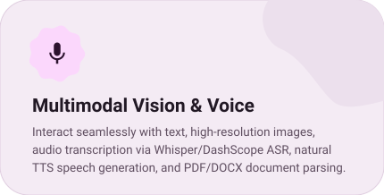</picture></a> |
| <a href="#updates" title="Smart In-App Updates"><picture><source media="(prefers-color-scheme: dark)" srcset="assets/readme/dark/card-updates.svg">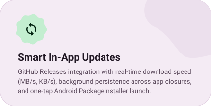</picture></a> | <a href="#faq" title="100% Zero-Leak Privacy"><picture><source media="(prefers-color-scheme: dark)" srcset="assets/readme/dark/card-privacy.svg"></picture></a> |

</div>

<h3 id="hardware"><picture><source media="(prefers-color-scheme: dark) and (max-width: 640px)" srcset="assets/readme/dark/hm-hardware.svg"><source media="(prefers-color-scheme: dark)" srcset="assets/readme/dark/h-hardware.svg"><source media="(max-width: 640px)" srcset="assets/readme/light/hm-hardware.svg"></picture></h3>

Local AI includes an embedded low-overhead hardware telemetry engine and custom power-budget controls located under **Settings ➔ Advanced Settings**:

* **Real-Time CPU & GPU Usage Monitor**: Compact, live-animated monitor card sampling `/proc/stat` and JVM runtime telemetry to provide instantaneous percentage utilization metrics without draining background battery.
* **Dual Power Limit Sliders (Default 70%)**:
  * **CPU Power Limit**: Default set to `70%`, adjustable from `10%` to `100%` with haptic feedback ticks on every 5% step.
  * **GPU Power Limit**: Default set to `70%`, adjustable from `10%` to `100%` to prevent thermal throttling during intensive local inference passes.
* **Display Smoothness & 120Hz Optimization**:
  * Full support for variable refresh rate displays (60Hz, 90Hz, 120Hz).
  * High-performance Compose list keying and memoized state derivations (`derivedStateOf`) to eliminate frame drops and scrolling stutters.

<h3 id="updates"><picture><source media="(prefers-color-scheme: dark) and (max-width: 640px)" srcset="assets/readme/dark/hm-updates.svg"><source media="(prefers-color-scheme: dark)" srcset="assets/readme/dark/h-updates.svg"><source media="(max-width: 640px)" srcset="assets/readme/light/hm-updates.svg">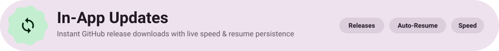</picture></h3>

The dedicated **App Updates** section (located directly under About in Settings) connects straight to GitHub Releases:

* **Semantic Version Comparison**: Verifies if the GitHub release tag is strictly newer than the currently installed build (`v1.2`). Lower or identical versions report "App is Up to Date".
* **Live Progress & Download Speed Counter**: Dynamic progress bar calculating transfer speeds in real time (**MB/s** and **KB/s** updated every 500ms) with total/downloaded byte tallies.
* **Persistence & Force-Close Recovery**: Downloaded APKs are cached safely in external files storage. If the user closes the app or swipes it away from Recents, the completed file is recognized instantly on reopen—enabling direct installation without re-downloading.
* **One-Tap Package Installer**: Direct integration with Android's secure `FileProvider` to launch package updates seamlessly.

<h3 id="architecture"><picture><source media="(prefers-color-scheme: dark) and (max-width: 640px)" srcset="assets/readme/dark/hm-architecture.svg"><source media="(prefers-color-scheme: dark)" srcset="assets/readme/dark/h-architecture.svg"><source media="(max-width: 640px)" srcset="assets/readme/light/hm-architecture.svg">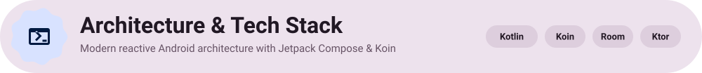</picture></h3>

<div align="center">

<a href="https://kotlinlang.org" target="_blank" rel="noopener noreferrer" title="Kotlin 2.1 Multiplatform Language"><picture><source media="(prefers-color-scheme: dark)" srcset="assets/readme/dark/pill-kotlin.svg"></picture></a>
<a href="https://developer.android.com/jetpack/compose" target="_blank" rel="noopener noreferrer" title="Android Jetpack Compose"><picture><source media="(prefers-color-scheme: dark)" srcset="assets/readme/dark/pill-compose.svg"></picture></a>
<a href="https://m3.material.io" target="_blank" rel="noopener noreferrer" title="Material 3 Expressive Design System"><picture><source media="(prefers-color-scheme: dark)" srcset="assets/readme/dark/pill-m3e.svg"></picture></a>
<a href="https://insert-koin.io" target="_blank" rel="noopener noreferrer" title="Koin 4 Dependency Injection"><picture><source media="(prefers-color-scheme: dark)" srcset="assets/readme/dark/pill-koin.svg"></picture></a>
<a href="https://developer.android.com/training/data-storage/room" target="_blank" rel="noopener noreferrer" title="Room v33 SQLite Persistence"><picture><source media="(prefers-color-scheme: dark)" srcset="assets/readme/dark/pill-room.svg"></picture></a>
<a href="https://ktor.io" target="_blank" rel="noopener noreferrer" title="Ktor 3.0 Embedded Server"><picture><source media="(prefers-color-scheme: dark)" srcset="assets/readme/dark/pill-ktor.svg"></picture></a>
<a href="https://square.github.io/okhttp/" target="_blank" rel="noopener noreferrer" title="OkHttp 5 & SSE Streaming"><picture><source media="(prefers-color-scheme: dark)" srcset="assets/readme/dark/pill-okhttp.svg"></picture></a>
<a href="https://proot-me.github.io" target="_blank" rel="noopener noreferrer" title="PRoot Linux User-Space Sandbox"><picture><source media="(prefers-color-scheme: dark)" srcset="assets/readme/dark/pill-proot.svg"></picture></a>
<a href="https://mupdf.com" target="_blank" rel="noopener noreferrer" title="MuPDF Native Document Engine"><picture><source media="(prefers-color-scheme: dark)" srcset="assets/readme/dark/pill-mupdf.svg"></picture></a>
<a href="https://react.dev" target="_blank" rel="noopener noreferrer" title="Embedded React Web UI"><picture><source media="(prefers-color-scheme: dark)" srcset="assets/readme/dark/pill-react.svg"></picture></a>

</div>

<br>

<table width="100%"><thead><tr><th align="left" width="22%">Module / Layer</th><th align="left" width="36%">Technology</th><th align="left">Architecture Role</th></tr></thead><tbody>
<tr><td><b>Presentation</b></td><td>Jetpack Compose + Navigation 2</td><td>Single-activity Compose host (<code>RouteActivity</code>) with type-safe screens and adaptive settings layouts.</td></tr>
<tr><td><b>Motion & Theme</b></td><td>Material 3 Expressive + PremiumHaptics</td><td>Spring physics (<code>damping=0.5f, stiffness=400f</code>), 12 tactile vibration patterns, and Light Slider tinting.</td></tr>
<tr><td><b>Dependency Injection</b></td><td>Koin 4 (Android + WorkManager)</td><td>Clean decoupled dependency graph spanning AppModule, DataSource, Repository, and ViewModel modules.</td></tr>
<tr><td><b>Data & Persistence</b></td><td>Room v33 (10 Entities, 10 DAOs)</td><td>Paging 3 conversation feeds, episodic vector embeddings, SHA-256 deduplicated chat attachments.</td></tr>
<tr><td><b>Local Sandbox</b></td><td>PRoot (CMake & C++ native runtime)</td><td>On-device unprivileged Linux guest environment executing scripts, Python commands, and developer CLI tools.</td></tr>
<tr><td><b>AI Orchestration</b></td><td><code>GenerationHandler</code> (~1800 lines)</td><td>Autonomous tool-calling loop (up to 256 steps), Pebble prompt templating, and SSE streaming pipeline.</td></tr>
<tr><td><b>Embedded Web UI</b></td><td>Ktor 3.0 Server + React Router 7</td><td>Embedded web server with HMAC-SHA256 JWT auth and NSD mDNS discovery for browser control.</td></tr>
<tr><td><b>Document Engine</b></td><td>MuPDF + XmlPullParser</td><td>High-speed extraction and prompt ingestion for PDF and DOCX attachments directly on-device.</td></tr>
</tbody></table>

<h3 id="install"><picture><source media="(prefers-color-scheme: dark) and (max-width: 640px)" srcset="assets/readme/dark/hm-install.svg"><source media="(prefers-color-scheme: dark)" srcset="assets/readme/dark/h-install.svg"><source media="(max-width: 640px)" srcset="assets/readme/light/hm-install.svg">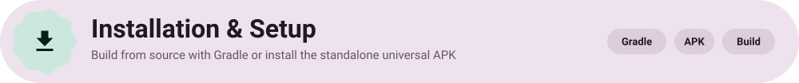</picture></h3>

#### 📱 Option A: Download Universal APK (Recommended)
1. Go to the [Releases](https://github.com/smartworldarafath/Local-AI/releases) page.
2. Download the latest `LocalAI_1.2_debug.apk`.
3. Open the downloaded APK on your Android device and confirm installation.

#### 💻 Option B: Build from Source

**Requirements**
* **JDK**: OpenJDK 17 or newer
* **Android SDK**: Compile SDK 36, Target SDK 36, Min SDK 28
* **Node.js**: v20.x or newer (for bundling embedded `web-ui/`)
* **NDK & CMake**: NDK 26+ and CMake 3.22+ (for building native PRoot workspace binaries)

```bash
# 1. Clone the repository
git clone https://github.com/smartworldarafath/Local-AI.git
cd Local-AI

# 2. Build the embedded Web UI
cd web-ui
npm install
npm run build
cd ..

# 3. Assemble the single universal APK
./gradlew :app:assembleDebug

# 4. Output location:
# app/build/outputs/apk/debug/LocalAI_1.2_debug.apk
```

<h3 id="faq"><picture><source media="(prefers-color-scheme: dark) and (max-width: 640px)" srcset="assets/readme/dark/hm-faq.svg"><source media="(prefers-color-scheme: dark)" srcset="assets/readme/dark/h-faq.svg"><source media="(max-width: 640px)" srcset="assets/readme/light/hm-faq.svg">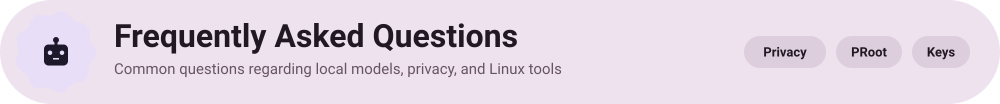</picture></h3>

**Are my chats and API credentials private?**  
Yes, 100%. Local AI has no centralized accounts or telemetry collectors. All API keys and tokens are encrypted via Android's hardware-backed `EncryptedSharedPreferences` through `SecretKeyManager`. SQLite databases remain strictly within your device's private app sandbox.

**How does the Linux PRoot sandbox function?**  
PRoot uses the Linux `ptrace` system call to emulate root file systems and system paths entirely in user-space. It allows executing shell scripts, Python, and terminal utilities inside an isolated Linux environment on Android without requiring device rooting.

**What does the Dual Power Limit Slider do?**  
It sets software execution limits for concurrent CPU worker threads and GPU offload limits (default 70%). This prevents your phone from overheating or throttling battery health during heavy inference sessions.

**Can I run local models offline?**  
Yes. You can connect Local AI to local Ollama endpoints or on-device LLM servers running on your phone or local WiFi network.

<h3 id="support"><picture><source media="(prefers-color-scheme: dark) and (max-width: 640px)" srcset="assets/readme/dark/hm-support.svg"><source media="(prefers-color-scheme: dark)" srcset="assets/readme/dark/h-support.svg"><source media="(max-width: 640px)" srcset="assets/readme/light/hm-support.svg"></picture></h3>

Local AI is an independent, ad-free, 100% open-source project. If it enhances your daily workflow, consider supporting development to help maintain Android 16 optimizations, new provider drivers, and Linux PRoot capabilities:

<div align="center">

<table width="100%">
  <tr>
    <td align="center" width="25%" valign="top">
      <h4> SupportKori</h4>
      <a href="https://www.supportkori.com/arafathrahman" target="_blank">
        
      </a><br/><br/>
      <a href="https://www.supportkori.com/arafathrahman" target="_blank">
        
      </a><br/>
      <sub>Cards · bKash · Nagad · Global</sub>
    </td>
    <td align="center" width="25%" valign="top">
      <h4> nsave</h4>
      <br/><br/>
      <br/>
      <sub>Ntag: <code>@arafath_rahman9</code><br/>Email: <code>arafathrahman711@gmail.com</code></sub>
    </td>
    <td align="center" width="25%" valign="top">
      <h4> RedotPay</h4>
      <br/><br/>
      <br/>
      <sub>ID: <code>184920485</code><br/>USDT · USDC · BTC · Visa</sub>
    </td>
    <td align="center" width="25%" valign="top">
      <h4> Payoneer</h4>
      <br/><br/>
      <br/>
      <sub>Email: <code>arafathrahman711@gmail.com</code><br/>Receiving Accounts (USD/EUR/GBP)</sub>
    </td>
  </tr>
</table>

<br>

<a href="https://github.com/sponsors/smartworldarafath" title="GitHub Sponsors"><picture><source media="(prefers-color-scheme: dark)" srcset="assets/readme/dark/card-sponsors.svg"></picture></a>

<br><br>

<table width="100%"><thead><tr><th align="left" width="24%">Method</th><th align="left" width="38%">Account / Identifier</th><th align="left">Details</th></tr></thead><tbody>
<tr><td><b>SupportKori</b></td><td><a href="https://www.supportkori.com/arafathrahman">supportkori.com/arafathrahman</a></td><td>Credit/Debit Cards, bKash, Nagad, and International payment methods.</td></tr>
<tr><td><b>nsave</b></td><td><code>arafathrahman711@gmail.com</code> (Ntag: <code>@arafath_rahman9</code>)</td><td>Swiss accounts · Direct EUR, USD & GBP transfers with zero cross-border hidden fees.</td></tr>
<tr><td><b>RedotPay</b></td><td>User ID: <code>184920485</code></td><td>RedotPay Visa virtual card & crypto wallet · Instant USDT, USDC, BTC, and internal ID transfers.</td></tr>
<tr><td><b>Payoneer</b></td><td><code>arafathrahman711@gmail.com</code></td><td>Direct bank-to-bank transfer or Payoneer-to-Payoneer in USD, EUR, GBP.</td></tr>
<tr><td><b>GitHub Sponsors</b></td><td><a href="https://github.com/sponsors/smartworldarafath">github.com/sponsors/smartworldarafath</a></td><td>Direct monthly or one-time project sponsorship.</td></tr>
<tr><td><b>Developer</b></td><td><b>Arafath</b> (<code>arafathrahman711@gmail.com</code>)</td><td>GitHub: <a href="https://github.com/smartworldarafath">@smartworldarafath</a></td></tr>
</tbody></table>

</div>

<br>

<div align="center">
<sub>Crafted with Google Material 3 Expressive · Spring Physics · Zero Telemetry · 100% Open Source under GNU GPL-3.0</sub>
</div>
